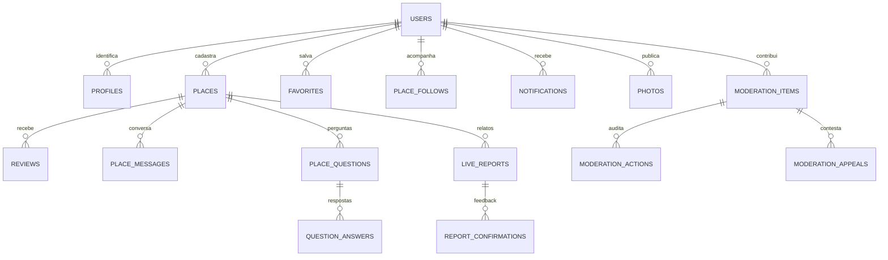

# Modelo de dados

Sete migrações versionadas. As duas fundações foram preservadas; 003–007 acrescentam Safe, mapa/mídia, perfil, duplicatas e recursos de suspensão.

Todos os objetos públicos têm RLS. Tables Safe adicionais: `safe_admins`, `safe_accounts`, `safe_write_events`, `ugc_reports`, `user_blocks`, `account_appeals`. `notification_preferences` é privada. Denúncias legadas de `content_reports` continuam disponíveis aos moderadores.

Cada UGC recebe estado e UUID de revisão. Autor não pode modificar autoria, estado, revisão, timestamps ou agregados. Lugares carregam origem community, coordenada/geografia opcional e declaração de estabelecimento público. Nome normalizado remove acentos e pontuação; candidatos aproximados são públicos e limitados. Duplicatas exatas normalizadas/cidade/UF e proximidade de 150m são bloqueadas com serialização. Sem coordenadas, nomes iguais na mesma cidade exigem resolução por moderador; filiais homônimas podem precisar de intervenção.

A view `place_ratings` calcula média apenas de avaliações aprovadas. RLS ainda respeita bloqueios/visibilidade por observador. Perguntas duram 60 min; relatos, 30 min. Confirmações têm unicidade e não transformam automaticamente um relato em verdade. Notificações de resposta só surgem após aprovação e têm chave de deduplicação.

Fotos pertencem a exatamente um lugar, avaliação ou perfil, com owner, tamanho, revisão e receipt de sanitização. Buckets privados: `community-photos` para staging e `reviewed-photos` para pixels sem metadados. A cópia revisada usa owner/revision e não pode ser escrita por clientes. URLs assinadas são limitadas no tempo.

Exclusão Auth remove por cascade perfil, avaliações, mensagens, fotos/filas pessoais, preferências e relações. Cadastros de lugares podem sobreviver com created_by null. Arquivos físicos são removidos antes pelo Storage API, não por SQL direto em storage.objects.
